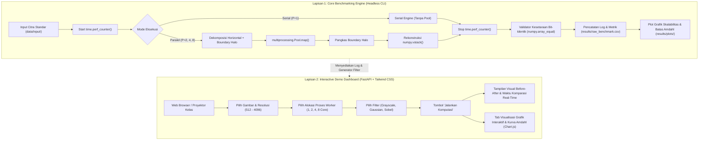
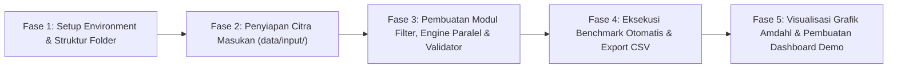

# Rencana Pengembangan Sistem Komputasi Paralel
**Judul Penelitian:** *Analisis Kinerja dan Skalabilitas pada Operasi Filter Citra Digital Menggunakan Komputasi Paralel Berbasis Multiprocessing*  
**Mata Kuliah:** Komputasi Paralel (Semester 5, Rekayasa Sistem Komputer, FMIPA UNTAN)  
**Target Hardware:** Intel Core i5-13420H (8 Cores: 4P + 4E, 12 Threads), 16 GB RAM, Windows 11 64-bit  
**Kebijakan Pengujian:** 1 Kali Pengujian per Titik Kombinasi (Deterministik Terkontrol)

---

## 1. Arsitektur Dua Lapis (Two-Tier Architecture)

Sistem dirancang dengan arsitektur dua lapis untuk menyeimbangkan antara **keabsahan data ilmiah** dan **daya tarik presentasi kelompok**:



1. **Lapisan 1: Core Benchmarking Engine (Skrip CLI Steril)**
   * Dijalankan tanpa *overhead* antarmuka pengguna untuk menjamin tidak ada perebutan siklus CPU antara *rendering* grafis dengan kalkulasi matriks.
   * Mengukur durasi komputasi murni dengan `time.perf_counter()`, utilisasi CPU dengan `psutil`, serta memverifikasi kesetaraan piksel via `numpy.array_equal`.
2. **Lapisan 2: Interactive Presentation Dashboard (Web Modern FastAPI + Tailwind CSS & Streamlit Legasi)**
   * Digunakan saat demo di depan dosen dan kelas dengan antarmuka modern *Milkinside Safe Dashboard white UI* berbasis FastAPI, Tailwind CSS, dan Chart.js (*dengan dashboard Streamlit `app.py` dipertahankan sebagai opsi legasi alternatif*).
   * Menyediakan antarmuka visual interaktif untuk memilih parameter, streaming benchmark via Server-Sent Events (SSE), perbandingan visual citra berdampingan (*side-by-side*), verifikasi bit-identik $\Delta_{\max} = 0$, dan kurva kinerja dinamis.

---

## 2. Struktur Direktori Proyek

```text
UTS/
├── data/
│   ├── dataset_30/                # Citra acuan master 4K (img_01.png) & dataset multiresolusi legasi
│   ├── input/                     # Citra masukan standar (512x512, 1024x1024, 2048x2048, 4096x4096)
│   └── output/                    # Citra hasil filter (Grayscale, Blur, Sobel)
├── src/
│   ├── __init__.py
│   ├── image_generator.py         # Pembuat citra sintetis RGB standar deterministik
│   ├── filters.py                 # Algoritma filter murni: Grayscale, Gaussian Blur, Sobel
│   ├── serial_engine.py           # Eksekutor mode serial baseline (P = 1 murni)
│   ├── parallel_engine.py         # Partisi baris horizontal + Pool.map + Boundary Halo (k=1)
│   ├── validator.py               # Uji kesetaraan bit-identik (numpy.array_equal)
│   ├── monitor.py                 # Pencatat utilisasi CPU per-core (psutil)
│   └── visualizer.py              # Generator kurva komparatif & kurva Amdahl (Matplotlib)
├── web/                           # Parallel Vision Workbench Modern (FastAPI + Tailwind CSS)
│   ├── backend/                   # Router API, service layer & bridge komputasi
│   ├── static/                    # CSS tokens, style Milkinside, JS modules, vendor assets
│   ├── templates/                 # Shell HTML5 dengan navigasi sidebar rail kiri
│   └── run_server.py              # Runner server web lokal (FastAPI + Uvicorn)
├── results/
│   ├── raw_benchmark.csv          # Dataset empiris seluruh titik kombinasi pengujian
│   └── plots/                     # Berkas gambar grafik untuk laporan dan slide
├── app.py                         # Aplikasi Web Dashboard Legasi (Streamlit - alternatif)
├── run_benchmark.py               # Runner utama CLI pengujian Skenario A, B, C
└── requirements.txt               # Daftar dependensi pustaka Python
```

---

## 3. Pembagian Peran & Tanggung Jawab Anggota (4 Pilar)

Untuk menjaga integritas arsitektur konkurensi sekaligus memastikan setiap anggota kelompok memiliki kontribusi nyata dan menguasai bahan saat tanya-jawab dosen:

| Anggota Tim | Peran / Spesialisasi | Berkas Tanggung Jawab | Deskripsi Tugas Teknis |
| :--- | :--- | :--- | :--- |
| **Muhammad Zaki Rakha Bahy** | **Lead Architect & Concurrency Engine** | `src/parallel_engine.py`<br>`run_benchmark.py`<br>`web/`<br>`app.py` | • Merancang partisi baris horizontal dan penanganan *boundary halo* ($k=1$).<br>• Mengelola `multiprocessing.Pool` dan rekonstruksi matriks dengan `numpy.vstack`.<br>• Mengorkestrasi eksekusi pengujian otomatis serta membangun Dashboard Web Modern (FastAPI + Tailwind) dan Streamlit. |
| **Ahmad Dzaky** | **Filter Algorithm Specialist** | `src/filters.py`<br>`tests/test_filters.py` | • Mengimplementasikan fungsi filter murni menggunakan matriks NumPy:<br>&nbsp;&nbsp;1. `apply_grayscale` (operasi titik luminansi $0.299R+0.587G+0.114B$).<br>&nbsp;&nbsp;2. `apply_gaussian_blur` (konvolusi $3\times3$, $k=1$).<br>&nbsp;&nbsp;3. `apply_sobel` (konvolusi gradien ganda $G_x, G_y$ dan magnitudo).<br>• Membuat *unit test* visual untuk memastikan filter tidak menghasilkan artefak warna. |
| **Farrel Nathannael** | **Hardware Profiling & Quality Assurance** | `src/monitor.py`<br>`src/validator.py` | • Mengimplementasikan pencatat beban prosesor dengan `psutil` untuk memantau core P dan core E.<br>• Membangun fungsi validasi kebenaran numerik (`numpy.array_equal(serial, paralel)`) untuk membuktikan keutuhan data hasil rekonstruksi paralel.<br>• Menghitung durasi beban tambahan (*parallel overhead*). |
| **Guido Marco Silvio** | **Data Engineering & Visualization** | `src/image_generator.py`<br>`src/visualizer.py` | • Membuat modul pembuat dataset citra masukan RGB standar pada 4 variasi resolusi.<br>• Membangun modul visualisasi grafik dengan Matplotlib:<br>&nbsp;&nbsp;1. Grafik Skenario A (Resolusi vs *Speedup* & Efisiensi).<br>&nbsp;&nbsp;2. Grafik Skenario B (Alokasi Proses vs *Speedup* Empiris vs Kurva Batas Amdahl).<br>&nbsp;&nbsp;3. Grafik Skenario C (Tingkat Kompleksitas vs *Overhead* & Utilisasi CPU). |

---

## 4. Spesifikasi Teknis Pemrosesan Paralel

### A. Jendela Pengukuran Waktu (*Timing Window*)
* **Di Luar Pengukuran:** Pembacaan berkas citra (`cv2.imread` dengan `cv2.setNumThreads(1)`), pembuatan pool proses (`multiprocessing.Pool(P)` *pre-warmed*), dan alokasi array awal.
* **Di Dalam Pengukuran:**
  1. Stempel waktu awal dicatat: `t_start = time.perf_counter()`.
  2. Dekomposisi matriks horizontal + penambahan *boundary halo* 1 baris.
  3. Pemanggilan `pool.map()` ke $P$ proses pekerja.
  4. Pekerja memproses blok dan memotong kembali baris halo.
  5. Penggabungan matriks utuh menggunakan `numpy.vstack()`.
  6. Stempel waktu akhir dicatat: `t_stop = time.perf_counter()`.
  7. Durasi eksekusi: $T = t_{stop} - t_{start}$.

### B. Matriks Titik Pengujian (Metodologi 30x Repetisi Berbobot Statistik)
Menggunakan 1 citra acuan master fotografi 4K (`img_01.png` center-crop) yang diuji sebanyak **30 kali repetisi** per perlakuan untuk memenuhi kaidah *Central Limit Theorem* ($N \ge 30$) dengan perlindungan jeda termal CPU:

1. **Skenario A (Pengaruh Dimensi Citra, P = 4 Inti Pekerja):**
   * Resolusi: $512 \times 512$, $1024 \times 1024$, $2048 \times 2048$, $4096 \times 4096$ piksel.
   * Filter: Grayscale (30x), Gaussian Blur (30x), Sobel (30x) = **90 pengujian per resolusi**.
   * Total pengujian Skenario A: 4 resolusi $\times$ 90 = **360 baris data**.
2. **Skenario B (Skalabilitas Alokasi Worker, Resolusi 2048 px):**
   * Alokasi proses: 1 proses (Serial Baseline), 2 proses, 4 proses, 8 proses worker.
   * Filter: Grayscale (30x), Gaussian Blur (30x), Sobel (30x) = **90 pengujian per alokasi worker**.
   * Total pengujian Skenario B: 4 konfigurasi worker $\times$ 90 = **360 baris data**.
3. **Skenario C (Analisis Kompleksitas Algoritma):**
   * Menganalisis korelasi beban hitung operasi titik (Grayscale), area (Gaussian Blur), dan gradien (Sobel) terhadap efisiensi, *overhead*, dan utilisasi CPU dari data Skenario B@P=4 (90 entri data).
4. **Metode Eksekusi di Dashboard Web:**
   * **Mode Bertahap / Terpandu (*Guided Stepper*)**: Eksekusi runtut per tahap (Tahap 1 $\rightarrow$ Tahap 2 $\rightarrow$ Tahap 3) secara akumulatif inkremental, mencegah *thermal throttling* CPU dengan jeda otomatis 2 detik.
   * **Mode Otomatis Penuh (*Full Batch Run*)**: Sekali klik serentak untuk pengujian kilat.

---

## 5. Roadmap Implementasi Bertahap



* **Fase 1:** Inisialisasi struktur direktori di `UTS/` dan penyiapan file dependensi `requirements.txt`.
* **Fase 2:** Implementasi `image_generator.py` dan pembuatan 4 citra uji standar.
* **Fase 3:** Implementasi `filters.py`, `parallel_engine.py`, `serial_engine.py`, dan pengujian kesetaraan bit piksel `validator.py`.
* **Fase 4:** Eksekusi `run_benchmark.py` untuk mengumpulkan seluruh data ke `raw_benchmark.csv`.
* **Fase 5:** Implementasi `visualizer.py` untuk ekspor grafik kurva dan pembangunan Dashboard Web Modern `web/` (FastAPI + Tailwind CSS + Chart.js) serta pemeliharaan `app.py` sebagai dashboard legasi.
